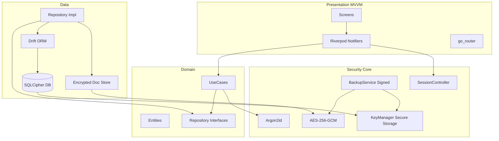

# Architecture Overview — GAZ HRMS

## Permission Enforcement Path

UI → PermissionGate / ViewModel check → UseCase → Repository (defense in depth)

## Offline-First

All primary workflows operate against local encrypted SQLite. No cloud dependency for MVP.
